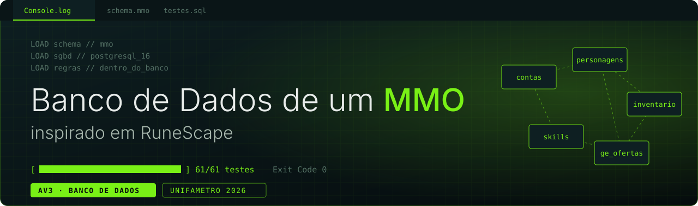
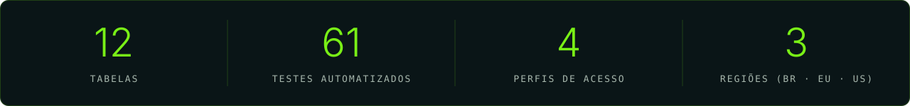
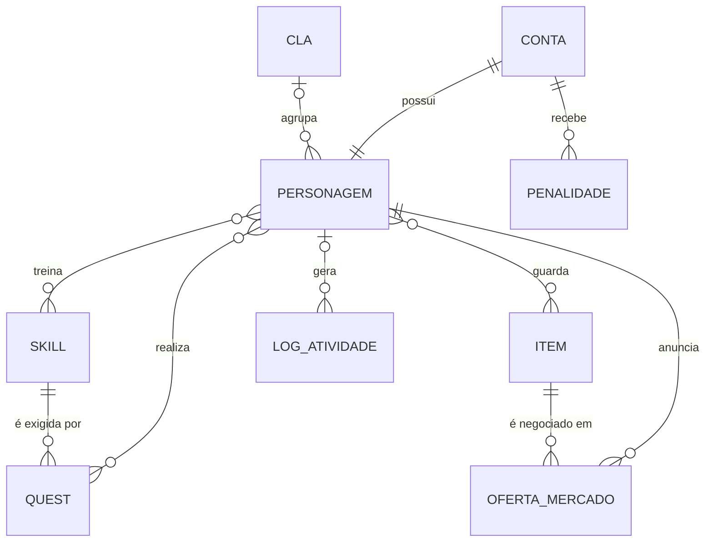
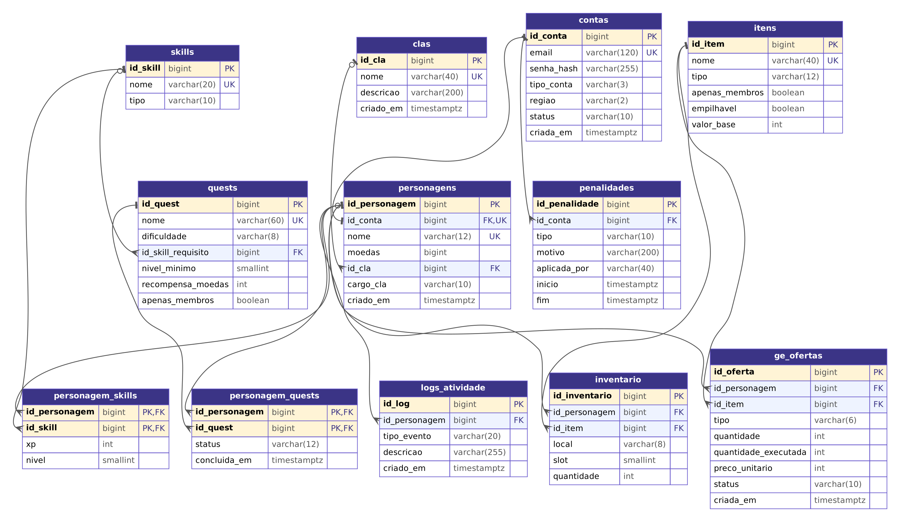
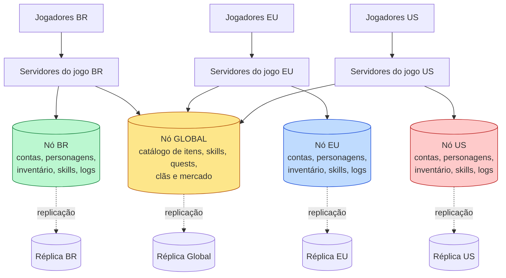

<p align="center"></p>

<p align="center">
  <a href="https://github.com/Tyonh/av3-banco-dados-mmo/actions/workflows/testes.yml"></a>
  
  
  
</p>

<p align="center"></p>

Banco de dados relacional para um jogo MMO (Massive Multiplayer Online), com contas, personagens, skills, itens, inventário, quests, clãs, mercado entre jogadores, penalidades e logs. As regras do jogo ficam **dentro do banco**: o PostgreSQL recusa um item duplicado, um saldo negativo ou uma compra pela metade, mesmo que a aplicação tenha um erro.

Trabalho da 3ª Avaliação (AV3) de **Técnicas de Implementação de Banco de Dados** — Análise e Desenvolvimento de Sistemas, UNIFAMETRO, 2026.

| | |
|---|---|
| **Equipe** | Antonio Geovane Porto Camelo · Esli Pompeu de Paulo Rufino Filho · Joel Caleb Coelho dos Santos · Lucas Amaro Oliveira |
| **Professor** | Kaio Mesquita |
| **SGBD** | PostgreSQL 16 |
| **Relatório** | [`docs/relatorio/AV3_Banco_de_Dados_MMO_ABNT.docx`](docs/relatorio/AV3_Banco_de_Dados_MMO_ABNT.docx) · [PDF](docs/relatorio/AV3_Banco_de_Dados_MMO_ABNT.pdf) (padrão ABNT, 36 páginas) |
| **Slides** | [`docs/apresentacao/AV3_Banco_de_Dados_MMO_slides.pdf`](docs/apresentacao/AV3_Banco_de_Dados_MMO_slides.pdf) (15 slides) |


`// INDEX`

## Sumário

- `01` [Como executar](#como-executar)
- `02` [Estrutura do repositório](#estrutura-do-repositório)
- `03` [Modelo de dados](#modelo-de-dados)
- `04` [Regras do jogo dentro do banco](#regras-do-jogo-dentro-do-banco)
- `05` [Controle de acesso](#controle-de-acesso)
- `06` [Compra no mercado e isolamento](#compra-no-mercado-e-isolamento)
- `07` [Testes](#testes)
- `08` [Arquitetura distribuída](#arquitetura-distribuída)
- `09` [Backup e recuperação](#backup-e-recuperação)
- `10` [Limitações](#limitações)


`STEP 01 // EXECUTAR`

## Como executar

Os scripts rodam em qualquer PostgreSQL 16 com um usuário administrador (o script cria perfis de acesso). Rode sempre nesta ordem:

| Ordem | Arquivo | O que faz |
|---|---|---|
| 1 | [`sql/mmo_banco.sql`](sql/mmo_banco.sql) | Cria o schema `mmo`, as 12 tabelas, views, a função de compra, os dados de exemplo e os perfis de acesso, e executa as consultas |
| 2 | [`sql/testes.sql`](sql/testes.sql) | Roda os 61 testes automatizados e mostra o resultado de cada um |
| 3 | [`sql/teste_concorrencia.sql`](sql/teste_concorrencia.sql) | Duas compras simultâneas da mesma oferta, para rodar em duas janelas |

Os dois primeiros podem ser executados quantas vezes você quiser: o script recria o schema do zero e os testes desfazem tudo o que fazem.

**No pgAdmin:** abra o Query Tool, carregue `sql/mmo_banco.sql` e execute (F5). Depois faça o mesmo com `sql/testes.sql`; o último resultado mostra `61 de 61 testes passaram`.

**No terminal (psql):**

```bash
psql -U postgres -v ON_ERROR_STOP=1 -f sql/mmo_banco.sql
psql -U postgres -v ON_ERROR_STOP=1 -f sql/testes.sql
bash scripts/teste_concorrencia.sh      # versão automática do teste de concorrência
```

**Sem PostgreSQL instalado (Docker):**

```bash
docker run --name mmo -e POSTGRES_PASSWORD=postgres -p 5432:5432 -d postgres:16
docker exec -i mmo psql -U postgres -v ON_ERROR_STOP=1 < sql/mmo_banco.sql
docker exec -i mmo psql -U postgres -v ON_ERROR_STOP=1 < sql/testes.sql
```

A cada envio ao GitHub, o [GitHub Actions](.github/workflows/testes.yml) sobe um PostgreSQL 16 limpo e faz esses mesmos três passos. O selo no topo desta página mostra o resultado da última execução.


`STEP 02 // ESTRUTURA`

## Estrutura do repositório

```
├── sql/
│   ├── mmo_banco.sql            DDL, views, função de compra, DML, DCL, consultas e transação
│   ├── testes.sql               61 testes automatizados
│   └── teste_concorrencia.sql   roteiro do teste de concorrência (duas janelas)
├── scripts/
│   └── teste_concorrencia.sh    teste de concorrência automático (usado no GitHub Actions)
├── docs/
│   ├── relatorio/               relatório técnico em Word, padrão ABNT
│   ├── apresentacao/            slides da apresentação em PDF
│   ├── diagramas/               modelo conceitual, modelo lógico (DER) e arquitetura
│   │   └── fontes/              arquivos-fonte dos diagramas (Mermaid e Graphviz)
│   └── dicionario_de_dados.md   todos os atributos de todas as tabelas
└── .github/workflows/testes.yml automação dos testes
```


`STEP 03 // MODELO`

## Modelo de dados

São **12 tabelas** organizadas em torno do personagem. Cada conta tem exatamente um personagem, como no RuneScape.



As relações N:N viram tabelas associativas: `personagem_skills` (XP e nível), `inventario` (local, espaço e quantidade) e `personagem_quests` (status).

| Tabela | Papel |
|---|---|
| `contas` | Login, tipo de conta (F2P/P2P), região e status |
| `personagens` | Avatar do jogador, moedas e clã |
| `clas` | Grupos de jogadores (guildas) |
| `skills` / `personagem_skills` | Catálogo de habilidades e o nível de cada personagem em cada uma |
| `itens` / `inventario` | Catálogo de itens e onde cada item está: mochila, banco ou equipado |
| `quests` / `personagem_quests` | Missões com nível exigido e o progresso de cada personagem |
| `ge_ofertas` | Ofertas de compra e venda no mercado (Grand Exchange) |
| `penalidades` | Punições aplicadas pela moderação |
| `logs_atividade` | Histórico de ações para auditoria |

O modelo lógico completo, com todos os atributos, tipos e chaves, está em [`docs/diagramas/modelo_logico.png`](docs/diagramas/modelo_logico.png) e no [dicionário de dados](docs/dicionario_de_dados.md).

<p align="center"></p>


`STEP 04 // REGRAS`

## Regras do jogo dentro do banco

| Regra do jogo | Como o banco garante |
|---|---|
| Uma conta tem um personagem | `UNIQUE (id_conta)` em `personagens` |
| Nível de skill vai de 1 a 99 | `CHECK (nivel BETWEEN 1 AND 99)` |
| Saldo de moedas nunca fica negativo | `CHECK (moedas >= 0)` |
| A mochila tem 28 espaços (0 a 27) | `CHECK` no espaço e índice único parcial por espaço |
| No banco, itens iguais ficam juntos | Índice único parcial `(id_personagem, id_item) WHERE local = 'banco'` |
| O mesmo item não é equipado duas vezes | Índice único parcial `WHERE local = 'equipado'` |
| Membro de clã tem cargo; quem não está em clã, não | `CHECK ((id_cla IS NULL) = (cargo_cla IS NULL))` |
| Clã com membros não pode ser apagado | Chave estrangeira com `ON DELETE RESTRICT` |
| Apagar a conta apaga os dados dela, mas não os logs | `ON DELETE CASCADE` nos dados e `ON DELETE SET NULL` nos logs |

Um detalhe que os testes revelaram: no SQL, `NULL BETWEEN 0 AND 27` não dá falso, dá "desconhecido", e um `CHECK` aceita o desconhecido. Por isso a regra da mochila exige `slot IS NOT NULL` explicitamente.

Três views completam o modelo: `vw_ranking` (ranking por nível e XP), `vw_jogador_publico` (dados do jogador **sem** email e senha) e `vw_preco_medio_mercado` (preços negociados por item).


`STEP 05 // ACESSO`

## Controle de acesso

Quatro perfis, seguindo o princípio do menor privilégio. Jogadores não acessam o banco: agem só pela aplicação.

| Perfil | Pode | Não pode |
|---|---|---|
| `admin_jogo` | Tudo | — |
| `moderador` | Consultar jogadores pela view, aplicar penalidades, mudar o status da conta | Ver email e senha (permissão por coluna); alterar a estrutura |
| `game_master` | Ver logs, mercado e inventário; restaurar itens perdidos | Alterar contas, apagar logs, executar compras |
| `app_server` | Inventário, skills, quests, compras e registro de logs | Alterar ou apagar logs; aplicar penalidades |

```sql
GRANT SELECT (id_conta, status) ON contas TO moderador;      -- nunca o email ou a senha
REVOKE UPDATE, DELETE ON logs_atividade FROM app_server;     -- a auditoria não pode ser apagada
REVOKE EXECUTE ON FUNCTION comprar_oferta(BIGINT, BIGINT, INT) FROM PUBLIC;
```


`STEP 06 // TRANSAÇÃO`

## Compra no mercado e isolamento

Toda compra passa pela função `comprar_oferta`, que confere as regras **antes** de mexer em moedas e itens e só roda em transação `SERIALIZABLE`:

```sql
BEGIN TRANSACTION ISOLATION LEVEL SERIALIZABLE;
    SELECT mmo.comprar_oferta(3, 9, 10);   -- JoelKnight compra 10 Lobsters da oferta 9
COMMIT;
```

| Código | Quando a compra é recusada |
|---|---|
| `MMO01` | A oferta não está aberta (inexistente, já concluída ou de compra) |
| `MMO02` | Quantidade inválida ou maior que a disponível |
| `MMO03` | Comprador sem moedas suficientes |
| `MMO04` | Conta gratuita (F2P) tentando comprar item de membros |
| `MMO05` | Jogador tentando comprar a própria oferta |
| `MMO06` | Chamada fora de uma transação `SERIALIZABLE` |

A função trava a oferta (`FOR UPDATE`) e trava comprador e vendedor sempre na mesma ordem, para evitar deadlock. Se duas compras disputam a mesma oferta, o PostgreSQL deixa só uma terminar:

```
Conexão 1 (JoelKnight): compra e confirma               -> recebe as 10 Lobsters
Conexão 2 (MarkPure):   espera a trava e é cancelada    -> ERROR: could not serialize access
                                                           due to concurrent update (40001)
```


`STEP 07 // TESTES`

## Testes

Cada regra afirmada no relatório virou um teste em [`sql/testes.sql`](sql/testes.sql). Cada teste executa um comando e confere se o banco aceitou ou recusou com o código de erro esperado (`23514` para `CHECK`, `23505` para `UNIQUE`, `42501` para falta de permissão…). No fim, tudo é desfeito.

| Grupo | Testes |
|---|---|
| Restrições | 26 |
| Estrutura do modelo (PKs, índices, fuso horário) | 3 |
| Consistência dos dados de exemplo | 3 |
| Views | 2 |
| Permissões | 16 |
| Compra no mercado e isolamento | 11 |
| **Total** | **61** |

A primeira versão do banco passou em **41 de 61**. As falhas revelaram erros reais, todos corrigidos:

- repetir uma compra já concluída cobrava e entregava os itens de novo;
- era possível equipar o mesmo item duas vezes;
- apagar um clã com membros dava erro, embora a documentação dissesse que só desvinculava os membros;
- 7 chaves estrangeiras não tinham índice;
- um personagem de exemplo estava numa quest sem o nível exigido.


`STEP 08 // ARQUITETURA`

## Arquitetura distribuída

Os dados dos jogadores ficam divididos por região (BR, EU, US); o que é compartilhado (catálogos, clãs e mercado) fica em um nó global; cada nó tem uma réplica de leitura que assume se o principal cair.

<p align="center"></p>

Uma compra envolve dois nós (a oferta no global, as moedas no regional). Para confirmar nos dois ou em nenhum, a proposta usa **commit em duas fases** (`PREPARE TRANSACTION` / `COMMIT PREPARED`). O script deste repositório roda em um banco único para demonstrar o modelo.


`STEP 09 // BACKUP`

## Backup e recuperação

| Tipo | Quando | Copia |
|---|---|---|
| Completo | Domingo, 04h | O banco inteiro |
| Diferencial | Segunda a sábado, 04h | O que mudou desde o último completo |
| Incremental | A cada 6 horas | O que mudou desde o último backup |
| WAL contínuo | Sempre | Cada transação confirmada |

Ferramenta proposta: **pgBackRest**. Com o WAL arquivado, um erro humano (como um `DELETE` sem `WHERE`) é desfeito voltando o banco para o minuto anterior (PITR). Uma vez por mês, um backup é restaurado num servidor de teste e o `testes.sql` roda nele.


`STEP 10 // LIMITES`

## Limitações

- Modelo simplificado: sem mundos, NPCs, tabelas de drop, trocas diretas, lista de amigos ou quests encadeadas.
- O banco não impede duas armas diferentes equipadas ao mesmo tempo (exigiria um trigger).
- A reserva do item ao anunciar uma venda é uma premissa; o script não a implementa.
- O banco não garante exatamente um líder por clã.
- Nível e XP ficam guardados juntos (redundância consciente, por desempenho).


<sub>Referências, justificativas e resultados completos estão no [relatório técnico](docs/relatorio/AV3_Banco_de_Dados_MMO_ABNT.pdf).</sub>
